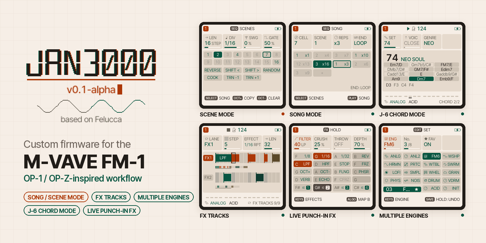

# JAN3000 (M-Vave-OP1)



OP-1 / OP-Z-inspired custom firmware for the **M-VAVE FM-1** pocket synthesizer.

JAN3000 is a fork of [Felucca](https://github.com/hugelton/Felucca) by Leo Kuroshita (Hügelton Instruments). It keeps
Felucca's hardware layer, USB, update loader, storage, engines and tests, and builds an OP-1 / OP-Z-style workflow on
top of it.

> **Status:** JAN3000 v0.1 alpha, the first public test version
> ([release notes](docs/RELEASE_NOTES.md)). Installing custom firmware is at your own risk: the FM-1 has a single
> firmware bank and no recovery button. If an install fails and the unit no longer starts, recovery needs extra
> hardware (FM-1 Transporter with an RP2040).

## Manual

📖 **[User manual (English and German)](https://jan3000-manual.vercel.app/)**: every feature and control
explained. The same manual is in this repository at [`web/manual/manual.html`](web/manual/manual.html).

## Features

- **Song / Scene Mode:** 16 scenes per project, switched while playing (at the end of the pattern or at the next
  bar), copied and cleared on the fly and chained into a scene song; SONG chains the project slots A to D. A KEY
  track moves the patterns through a chord progression, one per scene.
- **FX Tracks:** two lanes of effects next to the four instrument tracks, as on the OP-Z, each 1 to 64 steps long:
  repeat, reverse, filters, tape stop, freeze, pitch, flanger, phaser, throws and track mutes, step by step.
- **Multiple engines:** ANALOG2, VDRUM (six drum parts into a resonator), five engines after Mutable Instruments'
  Plaits (WSHAPE, HRMNC, PRTCL, WTABLE, SWARM) and ACID (a TB-303-style bass line), next to Felucca's own.
- **J-6 Chord Mode:** SCL > CHORD holds chord shapes and the 100 chord sets of the Roland J-6 on one knob; every key
  plays a chord of the set, live, in steps and through the arpeggiator.
- **Live punch-in FX:** hold FX and play the keys for punch-in effects, the OP-Z's set on a second key map (DUCK,
  STEREO, PITCH, RAMP UP, GLITCH), recorded onto the FX tracks; plus FX1 with a granular CLOUD.

## Installation

**You need:** an M-VAVE FM-1 that starts and runs normally, a Mac or Windows computer with **Python 3**, **Google
Chrome or Microsoft Edge** (Web MIDI), and a good USB cable.

1. Download **`M-Vave-OP1-Installer.zip`** from the
   [releases page](https://github.com/JanSchulten/JAN3000-M-Wave-Firmware/releases) (it is also in this repository
   at [`dist/M-Vave-OP1-Installer.zip`](dist/M-Vave-OP1-Installer.zip)).
2. Unzip it into a new folder.
3. Start the installer:
   - **Mac:** double-click `START-Mac.command` (the first time: right-click → Open, if macOS warns).
   - **Windows:** double-click `START-Windows.bat`.

   It serves the installer on your computer and opens it in Chrome or Edge. If the browser does not open, copy the
   address shown in the starter window into Chrome or Edge. Keep the starter window open while you install.
4. Connect the FM-1 via USB, click **Install** and allow MIDI (SysEx) access.
5. Wait until the progress bar reports **done**. The FM-1 restarts; the splash and MENU > SYSTEM > INFO show
   **JAN3000 v0.1-alpha**.

**While installing, never** unplug the cable, switch off the FM-1, close or reload the browser tab, or let the
computer go to sleep.

**If the install is interrupted:** the FM-1 usually waits in update mode. Open the same installer again and click
**Install** once more; it resumes the interrupted write.

**Back to the official firmware:** in the installer, open **Return to official V15** and use the V15 included in the
ZIP. It backs up your music to a file on your computer first; keep that file.

## Development

- Building the firmware: [BUILDING.md](BUILDING.md)
- Contributing: [CONTRIBUTING.md](CONTRIBUTING.md)
- Roadmap and backlog: [docs/ROADMAP.md](docs/ROADMAP.md), [docs/BACKLOG.md](docs/BACKLOG.md)
- Felucca's history is merged into this repository; upstream changes can be pulled in with:

  ```sh
  git remote add upstream https://github.com/hugelton/Felucca.git
  git fetch upstream
  git merge upstream/main
  ```

## Licence

GPL-3.0-only, like Felucca. Bundled and ported parts keep their own licences; see [LICENSING.md](LICENSING.md) and
`LICENSES/`. If you distribute this firmware, you must also offer its complete corresponding source under the same
licence.
