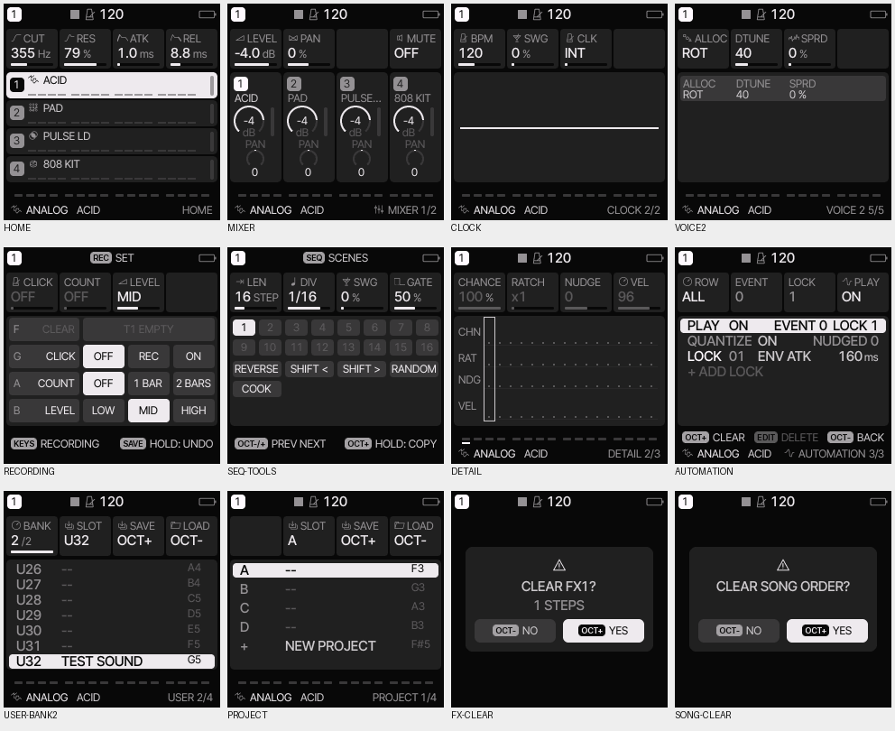
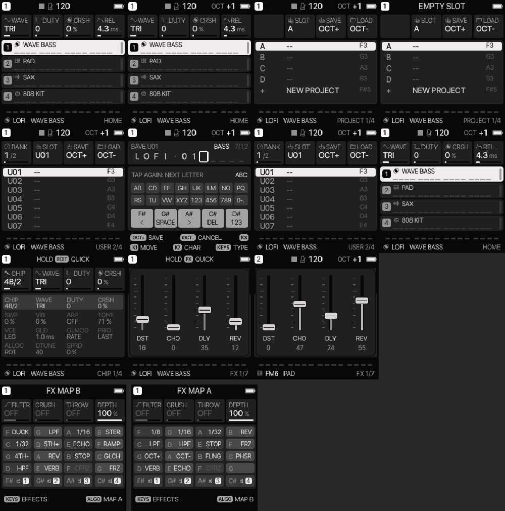

# JAN3000 controls: Phase 1 review

Work is isolated on `jan3000/ui-streamline-phase1`, based on main at
`b6af47da5c6634882ec1b01986793142db7e4aa9`. There is one commit for each of the eight Phase 1 points.
Phases 2 and 3 have not started. Nothing has been installed on hardware.

The user's decisions override the original clearing proposal: REV stays on FX > SEND and leaves MIXER;
whole-pattern CLEAR stays on REC + F3, clears notes and automation, and leaves SEQ + F#3.
PROJECT and USER use white-key slots, OCT+ save, OCT- load, F#3 rename and G#3 confirmed delete.
USER uses two banks of sixteen selected with KNOB 1. An empty PROJECT slot no longer starts a new project on OCT-;
F#5 is the remaining NEW action. Page buttons return HOME on a second tap, including a quick second tap;
REC alone retains its recording-layer double-tap lock. SELECT browses every family including HOME/MIXER/CLOCK.

SAVE held is the sole undo/redo. The opening transaction includes persistent mix, scale, sound, favorite,
drum mute, REC preference and FX-map changes. Temporary punch-ins follow their keys. A net-zero opening preserves
the preceding undo. A take groups its armed instrument tracks, motion, KEY, FX lanes or SONG chain entry;
SAVE disarms the take before swapping it. Undo retains the existing AUTOMATION FULL refusal if other tracks
have consumed the shared event capacity; it checks capacity before changing any part of a take.

Stored parameters, enum values, setting bits and project layouts retain their ordering. Retired native menu controls
keep their wire ids for older editors. Stored HOME LEVELS maps to TRACKS. Loader sources, the entire main.c
(including the boot guard), OTA sources, package identity, licenses and existing source headers are unchanged.
Golden audio renders remain the compatibility check; there is no intended audio-engine change.

## Measured target budgets

Measurements use JieLi toolchain 20260730.1 and AC79 SDK V1.2.1. Rows follow implementation order.
All values are bytes, except the static audio interrupt cost.

| Point | Image | RAM | Pool |
| --- | ---: | ---: | ---: |
| Baseline | 576648 | 52072 | 339724 |
| 6: octave keys | 576176 | 52072 | 339724 |
| 2: mixer / voice homes | 575288 | 52072 | 339724 |
| 4: REC settings | 575288 | 52072 | 339724 |
| 7: step values | 573664 | 52072 | 339724 |
| 3: clearing | 573352 | 52072 | 339724 |
| 5: SELECT / HOME | 573056 | 52072 | 339724 |
| 8: storage | 573816 | 52072 | 339724 |
| 1: grouped undo | 575872 | 52024 | 348044 |
| Limit | 581564 | 73728 | 368640 |

The pool has 20596 bytes free, above the required 8192-byte reserve. Image space free: 5692 bytes.
The measured `fm1_alnk0_irq` static cost is unchanged: 40344 → 40344 (limit 41252).

## Validation

Each point has a behavior regression demonstrated red before its implementation, then green. Target builds
and `python3 tests/target_budget.py` pass. Each point is checked with `sh tests/run_tests.sh`; the exact final
sentinel is required, including the UI alignment lint. All eight point runs end with `ALL HOST TESTS PASSED`.
The final frozen source also exits 0 with that exact last line, including its fresh WebAssembly build and tests.
The automatic sanitizer probe cannot enumerate `/proc` in this environment. All eleven scripted ASan/UBSan
checks plus the new workflow test were therefore compiled and run separately with the suite's flags and
`__asan_default_options` / `__lsan_default_options` disabling leak detection. All twelve pass, including editor
fuzzing (20000 inputs, seed 7), project fuzzing (5000, seed 13) and sample fuzzing (1000, seed 17). Leak checking
remains unavailable; address and undefined-behavior instrumentation ran.

The new `tests/workflow_test.c` is registered in that script and also captures the screens below when passed a directory.
The final UI sweep has no lint findings and no alignment errors in either normal or optional FM4 builds:
2764407 measurements in the normal build and 2965865 in the FM4 build. All 131 golden audio renders remain unchanged.

`sh web/emu/build.sh` and the Node tests of each point's WebAssembly build pass: boot, panel controls, storage,
audio determinism and the heavy-song workload. The images below come from the real C UI host harness, in GREY, and
were inspected; the browser screenshots further down come from the follow-up review.

README, the matching EN/DE manual sections (German ids prefixed `de-`) and the Lab workflows are updated.
Manual ids are unique and both language trees cover the same sections.

## Review follow-up

A review of the eight commits found two regressions, each now fixed with a test in `tests/workflow_test.c` that fails
without its fix and passes with it:

- **Undo during automation restored the sounding value instead of the patch.** `undo_capture` and the sound signature
  now read `motion_base_value`; `undo_swap` restores, exchanges and rebases the motion in one guarded batch, so the
  patch base survives further automated steps and STOP.
- **OCT- on PROJECT / USER transposed the keyboard.** The octave handler now leaves OCT to the storage pages
  (`slots_keys_on`); save, load, overwrite and their cancellations keep the octave, and OCT transposes again after
  leaving storage.

The FX layer's message for the second key map now reads `FX MAP B` (formerly `FX MAP B: OP-Z`); `punch_test` checks
the exact text.

After these three commits: image 576020 B (limit 581564), RAM 52024 B, pool 348044 B, `fm1_alnk0_irq` 40344
(unchanged). `sh tests/run_tests.sh` ends with `ALL HOST TESTS PASSED`, including the sanitizer runs (all eleven ran
here without the workaround above), both UI alignment lints with 0 findings and the emulator's Node tests.

The browser emulator was driven with Playwright in Chromium (colour palette, no console errors): OCT+ on HOME, then
SAVE > PROJECT, OCT- on an empty slot (EMPTY SLOT), SELECT to USER, OCT+ to the NAME screen and OCT- to cancel. `OCT +1`
stays in the header throughout and on HOME afterwards. Holding FX and turning ALGORITHM shows `FX MAP B` / `FX MAP A`.

## Remaining device checks and upstream merges

Only hardware can establish encoder feel, tap/hold timing, recording latency, LED brightness and the physical
audio output. No installation or hardware test was performed.

Future Felucca merges will need particular care in `ui.c`, `ui_input.c`, `ui_layer.c` and the page/menu tables:
navigation, grouped undo, slot gestures and sparse menus now diverge from the upstream workflow. Stored sound
and project formats are kept compatible to limit that cost. The isolated changes remain GPL-3.0-only and based on Felucca.
